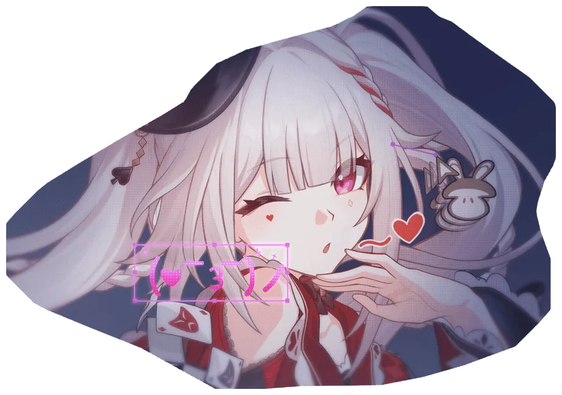
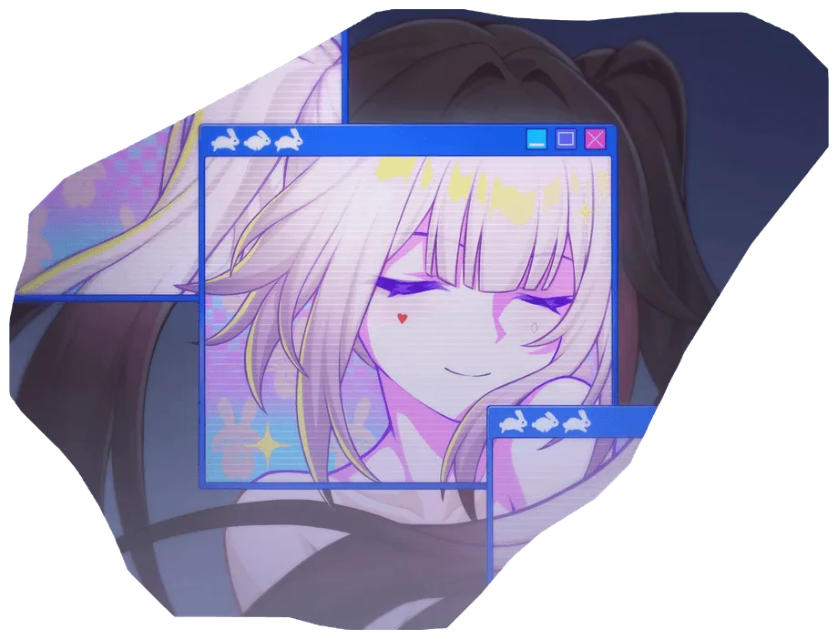

<p align="center">
  
</p>

<h3 align="center">hi i'm mewski and i have never once read the documentation</h3>

<p align="center"><i>reverse engineer. systems security. bug haver. unpaid intern of my own segfaults.</i></p>

```console
$ ./mewski --help
segmentation fault (core dumped)
$ ./mewski --help
segmentation fault (core dumped)
$ sudo ./mewski --help
ok fine
```

- rename `sub_401000` to `the_evil_one` and call it a night
- if it works on my machine it ships on my machine
- my threat model is me at 4am
- diagnosed with ai psychosis. the agent says i'm fine and honestly it's never lied to me

<p align="center">
  
  
  
  
  
  
</p>

<p align="center">
  <a href="https://mewski.dev"><b>mewski.dev</b></a> ✦ more hex, fewer answers
</p>
